# Capítulo II: Requirements Elicitation & Analysis

## 2.1. Competidores
Para desarrollar una solución efectiva, es importante entender la situación competitiva y las diferentes variantes que se utilizan en los laboratorios farmacéuticos. Este análisis nos ayuda a identificar cómo se gestionan los procesos de calidad actualmente y qué limitaciones presentan las soluciones existentes.

En este periodo, se analizan distintos tipos de competidores con el objetivo de entender sus fortalezas y debilidades, y así posicionar a DoofPlus como una propuesta que responda de manera más efectiva a las necesidades reales del sector.

### 2.1.1. Análisis competitivo
A continuación, se presenta una tabla comparativa sobre los principales competidores, en el que se considera su propuesta de valor, mercado objetivo y características generales. Este análisis permite evidenciar que, mientras las soluciones existentes se orientan a grandes corporaciones o dependen de procesos manuales, DoofPlus se posiciona como una alternativa especializada, accesible y centrada en la automatización del aseguramiento de la calidad mediante integración IoT y trazabilidad digital, especialmente pensada para laboratorios medianos y entidades públicas de la región.

<table>
  <tr>
    <th colspan="6"><b>Competitive Analysis Landscape</b></th>
  </tr>
  <tr>
    <td colspan="2">¿Por qué llevar a cabo este análisis?</td>
    <td colspan="4">¿Cómo se posiciona DoofPlus frente a sus competidores en fortalezas, debilidades, oportunidades y propuesta de valor dentro del mercado de software de gestión de calidad y trazabilidad farmacéutica?  Es una propuesta que posiciona a DoofPlus como una plataforma SaaS orientada a la gestión de calidad farmacéutica, incorporando integración IoT para automatizar la captura de datos, mejorar la trazabilidad y asegurar el cumplimiento normativo frente a otras soluciones del mercado.</td>
  </tr>
  <tr>
    <td colspan="2"></td>
    <td>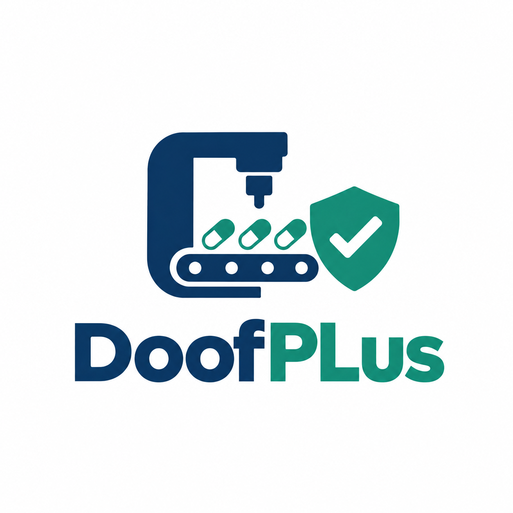 <b>DoofPlus</b></td>
    <td> <b>TuHub</b></td>
    <td> <b>LOLFAR (LOLIMSA)</b></td>
    <td> <b>DrugXafe (Tiga Healthcare)</b></td>
  </tr>
  <tr>
    <td rowspan="2">Perfil</td>
    <td>Overview</td>
    <td>Plataforma SaaS bilingüe de gestión de calidad y trazabilidad de lotes para laboratorios farmacéuticos, con integración de sensores IoT.</td>
    <td>Plataforma MES de gestión de producción que integra IoT industrial, monitoreo de OEE en tiempo real y batch record electrónico (Colombia).</td>
    <td>Software de gestión farmacéutica para farmacias y cadenas: ventas, inventario, logística y control de vencimientos; más de 30 años en el mercado.</td>
    <td>Sistema de track &amp; trace que serializa cada empaque con un código 2D Data Matrix y registra su recorrido del productor al paciente.</td>
  </tr>
  <tr>
    <td>Ventaja competitiva ¿Qué valor ofrece a los clientes?</td>
    <td>Especialización en QA/QC (documentos, desviaciones, CAPA, liberación) con precio accesible y enfoque en BPM de DIGEMID: encontrar cualquier evidencia de un lote en minutos y preparar auditorías sin compilar documentos.</td>
    <td>Captura automática de datos de planta (sensores, PLC, SCADA) y dashboards multi-planta para reducir pérdidas de producción y mejorar la eficiencia (OEE).</td>
    <td>Trayectoria y base instalada en más de 12 países; reduce costos logísticos (10–15%) y evita quiebres de stock y mermas por vencimiento.</td>
    <td>Prevención de falsificaciones y fraude en la cadena de suministro: garantiza que solo medicamentos auténticos lleguen al paciente.</td>
  </tr>
  <tr>
    <td rowspan="2">Perfil de marketing</td>
    <td>Mercado objetivo</td>
    <td>Laboratorios farmacéuticos pequeños y medianos de Lima y, luego, de la región andina.</td>
    <td>Manufactura regulada y no regulada (alimentos, farmacéuticos, cosméticos) en Colombia y Latinoamérica.</td>
    <td>Farmacias, boticas, cadenas, clínicas y hospitales de Latinoamérica.</td>
    <td>Fabricantes, importadores, distribuidores y autoridades sanitarias.</td>
  </tr>
  <tr>
    <td>Estrategias de marketing</td>
    <td>Contenido educativo sobre BPM e integridad de datos, precios públicos y registro de la organización desde la Landing Page, y presencia en eventos del sector.</td>
    <td>Marketing digital B2B (blog, casos de éxito) y webinars sobre gestión de calidad.</td>
    <td>Venta consultiva B2B con implementación y soporte locales.</td>
    <td>Venta B2B y B2G a actores de la cadena de suministro y reguladores.</td>
  </tr>
  <tr>
    <td rowspan="3">Perfil de producto</td>
    <td>Productos &amp; Servicios</td>
    <td>Documentos y SOP, expediente de lote, desviaciones y CAPA, liberación, audit trail, reportes, dashboards e IoT.</td>
    <td>MES, monitoreo OEE, batch record electrónico, IA para operaciones y mantenimiento.</td>
    <td>Módulos de ventas, compras, almacenes, fidelización y facturación para farmacias.</td>
    <td>Serialización, agregación de empaques y reportes de trazabilidad.</td>
  </tr>
  <tr>
    <td>Precios &amp; Costos</td>
    <td>Standard Lab US$199/mes (US$1,990/año); Enterprise US$599/mes (US$5,990/año).</td>
    <td>Suscripción e implementación cotizadas por planta (precios no publicados).</td>
    <td>Licencia, implementación y soporte cotizados por proyecto (precios no publicados).</td>
    <td>Costo por volumen de códigos e implementación (precios no publicados).</td>
  </tr>
  <tr>
    <td>Canales de distribución (Web y/o Móvil)</td>
    <td>Plataforma web responsive (desktop, tablet y mobile).</td>
    <td>Plataforma web en la nube y dispositivos IoT en planta.</td>
    <td>Aplicación de escritorio/web en las estaciones de farmacia.</td>
    <td>Portales web e integración por API.</td>
  </tr>
  <tr>
    <td rowspan="4">Análisis SWOT</td>
    <td>Fortalezas</td>
    <td>Especialización en calidad farmacéutica; bajo costo; bilingüe; integración IoT sin vender hardware.</td>
    <td>Integración IoT madura; batch record electrónico; operación multi-planta.</td>
    <td>Trayectoria; presencia internacional; ahorro logístico comprobado.</td>
    <td>Especialización en serialización y anti-falsificación.</td>
  </tr>
  <tr>
    <td>Debilidades</td>
    <td>Startup sin base instalada; marca poco conocida; requiere validación por el cliente.</td>
    <td>Enfoque en eficiencia productiva, no en QA (CAPA, liberación, auditorías); operación centrada en Colombia.</td>
    <td>Orientado a retail farmacéutico; no cubre manufactura, control de calidad ni IoT.</td>
    <td>Solo cubre empaque y distribución; no monitorea la fabricación ni la gestión de calidad.</td>
  </tr>
  <tr>
    <td>Oportunidades</td>
    <td>Fiscalización más estricta de DIGEMID; crecimiento del sector farmacéutico; digitalización de laboratorios.</td>
    <td>Expansión a Perú impulsada por Industria 4.0.</td>
    <td>Crecimiento de cadenas de farmacias.</td>
    <td>Regulaciones de serialización obligatoria en la región.</td>
  </tr>
  <tr>
    <td>Amenazas</td>
    <td>Resistencia al cambio; ciclos de venta largos; ingreso de grandes proveedores de QMS.</td>
    <td>Competidores especializados en QMS farmacéutico.</td>
    <td>Soluciones SaaS más modernas y económicas.</td>
    <td>Proveedores globales de serialización.</td>
  </tr>
</table>

### 2.1.2. Estrategias y tácticas frente a competidores

Para posicionar a DoofPlus frente a TuHub (MES con IoT), LOLFAR (gestión de farmacias) y DrugXafe (serialización), IngesCompany aplicará las siguientes estrategias y tácticas:

#### Estrategia de costos y accesibilidad (suscripción sin inversión inicial)

Frente a soluciones cotizadas por proyecto con costos de implementación elevados (TuHub, LOLFAR), DoofPlus ofrece precios públicos por suscripción (Standard Lab y Enterprise) sin inversión en servidores ni hardware propio, ya que la captura IoT se integra con ThingsBoard. Táctica: el laboratorio registra su organización desde la Landing Page y elige su plan sin intermediarios; la modalidad anual equivale a dos meses gratis.

#### Enfoque vertical en la calidad farmacéutica

Mientras TuHub se enfoca en la eficiencia productiva (OEE), LOLFAR en la gestión comercial de farmacias y DrugXafe en el empaque y la distribución, DoofPlus cubre el ciclo de calidad del lote: documentación controlada, desviaciones y CAPA, cuarentena y liberación con firma electrónica, y audit trail. Táctica: plantillas de protocolos y reportes alineadas a las BPM de DIGEMID, configurables por cada laboratorio (la validación final corresponde al cliente).

#### Gestión multi-planta y trazabilidad centralizada de lotes

Se ofrece una única cuenta por organización con varias plantas y líneas de producción, de modo que QA/QC y Producción consulten la misma información del lote. Táctica: el plan Enterprise habilita sensores ilimitados y gestión multi-planta para instituciones como el INS.

#### Estrategia comercial B2B dirigida

La prospección se dirige a jefes de aseguramiento de calidad y de producción, demostrando la reducción del tiempo de preparación de auditorías y del riesgo de observaciones de DIGEMID. Tácticas: webinars sobre integridad de datos, casos de uso con los primeros laboratorios suscritos y alianzas con consultores de BPM.

#### Funciones diferenciadoras

Del análisis realizado se concluye que DoofPlus puede adoptar características consolidadas del mercado, como la captura automática de datos mediante IoT, la trazabilidad digital y los paneles de monitoreo; no obstante, su principal factor diferenciador radica en integrar en una sola plataforma los procesos de calidad y producción farmacéutica. Esta propuesta permite cubrir necesidades que actualmente se encuentran dispersas entre distintas soluciones, incorporando gestión documental, desviaciones, CAPA, liberación de lotes, auditorías y cumplimiento regulatorio, orientados específicamente al contexto de laboratorios farmacéuticos de la región.

## 2.2. Entrevistas

Las entrevistas constituyen una herramienta fundamental para obtener información cualitativa directamente de los profesionales involucrados en los procesos de aseguramiento de calidad y producción farmacéutica. A través de conversaciones estructuradas, se busca comprender sus actividades, necesidades, desafíos, comportamientos y experiencias relacionadas con la gestión de documentación, la trazabilidad de lotes y el acceso a la información. La información recopilada permitió identificar problemáticas, oportunidades de mejora y necesidades reales del entorno de aplicación, contribuyendo a definir una propuesta de solución alineada con los requerimientos y expectativas de los segmentos objetivo.

### 2.2.1. Diseño de entrevistas

Teniendo en cuenta la importancia de la información que pueden proporcionar los entrevistados, se presentan las preguntas clave para cada segmento objetivo identificado. Para ello, se consideran dos tipos de preguntas: las personales, orientadas a conocer el perfil profesional y la experiencia de los participantes dentro de la industria farmacéutica, y las específicas, enfocadas en comprender los procesos actuales relacionados con la gestión de calidad, la trazabilidad de lotes, el acceso a la información, la gestión documental y la coordinación entre las áreas de producción y aseguramiento de la calidad. Asimismo, se busca identificar las principales dificultades, necesidades y oportunidades de mejora presentes en sus actividades diarias, con el fin de obtener información relevante para la definición de la propuesta de solución.

#### Segmento Objetivo: Especialista de Aseguramiento y Control de Calidad (QA/QC)

##### Preguntas personales

- ¿Cuál es su nombre?
- ¿Cuál es su edad?
- ¿Que dispositivo y buscador emplea?
- ¿Cuál es su cargo actual dentro de la organización?
- ¿Cuántos años de experiencia tiene trabajando en aseguramiento o control de calidad farmacéutica?

##### Preguntas específicas

- ¿Cómo gestiona actualmente los protocolos, registros y documentación relacionada con la calidad de los productos farmacéuticos?
- ¿Qué tipo de información necesita consultar con mayor frecuencia para realizar sus actividades de aseguramiento o control de calidad?
- ¿Cuáles son las principales dificultades que encuentra al buscar información o documentación relacionada con un lote específico?
- ¿Cómo realiza el seguimiento de desviaciones, incidencias o no conformidades dentro de los procesos de calidad?
- ¿Cuánto tiempo suele dedicar a recopilar información o evidencias para auditorías, inspecciones o revisiones internas?
- ¿Qué problemas ha experimentado relacionados con la trazabilidad de los registros o la disponibilidad de información histórica?
- Si pudiera mejorar una actividad relacionada con la gestión de calidad dentro de su organización, ¿cuál sería y por qué?

#### Segmento Objetivo: Jefe o Supervisor de Producción Farmacéutica

##### Preguntas personales

- ¿Cuál es su nombre?
- ¿Cuál es su edad?
- ¿Que dispositivo y buscador emplea?
- ¿Cuál es su cargo actual dentro de la organización?
- ¿Cuántos años de experiencia tiene supervisando procesos de producción farmacéutica?

##### Preguntas específicas

- ¿Cómo realiza actualmente el seguimiento de los lotes durante las diferentes etapas del proceso de fabricación?
- ¿Qué información considera más importante para supervisar el estado de la producción y tomar decisiones operativas?
- ¿Qué herramientas o sistemas utiliza para consultar información relacionada con la producción?
- Cuando ocurre una incidencia o desviación durante la fabricación, ¿cómo se registra y comunica dicha información?
- ¿Cuáles son las principales dificultades que encuentra al acceder al historial de producción de un lote específico?
- ¿Qué tan sencillo o complejo resulta coordinar el intercambio de información con las áreas de aseguramiento y control de calidad?
- Si pudiera mejorar un aspecto relacionado con el acceso o gestión de la información de producción, ¿qué cambiaría y por qué?

### 2.2.2. Registro de entrevistas

En esta sección se presentan los resultados obtenidos de las entrevistas realizadas a los segmentos objetivo identificados para DoofPlus. Para cada entrevista se incluyen los datos generales del participante, un resumen de las respuestas más relevantes, las observaciones realizadas durante la sesión y las principales conclusiones obtenidas. La información recopilada permite comprender las necesidades, dificultades y experiencias de los profesionales vinculados a los procesos de aseguramiento de calidad y producción farmacéutica, constituyendo una fuente de evidencia para la validación de los supuestos planteados y para la definición de las funcionalidades y características de la solución propuesta.

**Segmento 1: Especialista de Aseguramiento y Control de Calidad (QA/QC)**

| Numero | 1 |
|---------|--------|
| **Campo** | **Información** |
| Nombre | María |
| Apellido | México |
| Edad | 53 |
| Distrito | San Juan de Lurigancho |
| Evidencia |  |
| Link | https://shorturl.at/c0pBO |
| Inicio | 00:00 min |
| Duración | 04:38 min |
| Resumen | María México es química farmacéutica y se desempeña en el área de Control de Calidad de un laboratorio farmacéutico. Entre sus funciones principales se encuentran la validación de procesos, la revisión documental, la verificación de equipos y la evaluación del personal analista para asegurar el cumplimiento de los estándares de calidad.  Para el desarrollo de sus actividades utiliza computadoras y sistemas digitales de gestión de calidad, complementados con documentación física. Gestiona información relacionada con registros de análisis, protocolos, reportes de conformidad y no conformidad, resultados analíticos e informes de validación.  Uno de los principales problemas identificados es la revisión manual de cálculos e informes analíticos antes de registrar los resultados en el sistema, actividad que consume una cantidad considerable de tiempo y aumenta el riesgo de errores operativos. Asimismo, la coexistencia de procesos físicos y digitales genera tareas repetitivas y mayores esfuerzos de control.  Las desviaciones detectadas son investigadas mediante el análisis de posibles causas asociadas al personal, los equipos o el producto, manteniendo registros actualizados para auditorías e inspecciones regulatorias.  María considera que la implementación de una plataforma integrada que permita automatizar la revisión de resultados, generar reportes automáticos y centralizar la documentación de calidad contribuiría significativamente a reducir la carga administrativa y mejorar la trazabilidad de la información. |

| Numero | 2 |
|---------|--------|
| **Campo** | **Información** |
| Nombre | Julia  |
| Apellido | Collasos Zotelo |
| Edad | 64 |
| Distrito | San Miguel |
| Evidencia |  |
| Link | https://shorturl.at/c0pBO |
| Inicio | 04:39 min |
| Duración | 04:59 min |
| Resumen | Julia Collasos Zotelo es química farmacéutica y trabaja en el área de Aseguramiento de la Calidad del Centro de Producción de Productos Biológicos del Instituto Nacional de Salud. Sus funciones incluyen la supervisión del sistema de calidad, la verificación del cumplimiento de las Buenas Prácticas de Manufactura (BPM), la revisión documental y la participación en auditorías internas y externas.  Para ejecutar sus actividades utiliza computadora o laptop, Microsoft Word, Microsoft Excel, Google Chrome y sistemas institucionales de gestión documental y control de procesos. Asimismo, trabaja con procedimientos normalizados, registros de producción, protocolos de validación, documentación técnica y sistemas de trazabilidad de lotes.  Julia destaca que la organización dispone de mecanismos que permiten identificar información relacionada con proveedores, materias primas, operadores y productos terminados. Sin embargo, menciona que existen dificultades para acceder oportunamente a determinadas fuentes de información y que algunos problemas se originan cuando los colaboradores no siguen adecuadamente los procedimientos establecidos.  Las desviaciones y no conformidades son registradas e investigadas mediante metodologías de análisis de causa raíz, implementándose acciones correctivas y preventivas coordinadas por equipos multidisciplinarios.  Considera que una de las principales oportunidades de mejora consiste en fortalecer las capacidades del personal para analizar problemas, mejorar el registro de información y asumir una cultura de calidad compartida por toda la organización. |

| Numero | 3 |
|---------|--------|
| **Campo** | **Información** |
| Nombre | Edith |
| Apellido | Espinoza |
| Edad | 31 |
| Distrito | Lima |
| Evidencia |  |
| Link | https://shorturl.at/c0pBO |
| Inicio | 09:37 min |
| Duración | 04:58 min |
| Resumen | Edith Espinoza es técnica de enfermería con experiencia en procesos de atención y gestión de información clínica relacionados con pacientes pediátricos. Sus funciones principales comprenden la validación de seguros, la verificación de datos de pacientes y el seguimiento de información asociada a vacunas y medicamentos.  Para realizar sus actividades utiliza computadoras, laptops, dispositivos Android y sistemas digitales de registro institucional, además de documentación física y expedientes clínicos digitalizados.  La documentación gestionada incluye historias clínicas, registros de aseguramiento, datos de pacientes y reportes asociados a la administración de medicamentos. Aunque la organización viene desarrollando procesos de digitalización, todavía existe una coexistencia entre registros físicos y digitales.  Entre las principales dificultades identificadas se encuentra la consulta de información proveniente de múltiples entidades externas, especialmente cuando los pacientes cuentan con más de un seguro o cuando parte de su información no se encuentra integrada en el sistema institucional.  Las incidencias relacionadas con medicamentos, como errores de medicación o detección de lotes vencidos, son registradas mediante reportes que permiten iniciar procesos de seguimiento, devolución o reposición.  Edith considera que una mayor integración de la información, junto con la automatización de registros y consultas, permitiría mejorar la trazabilidad, reducir errores administrativos y agilizar la atención de los pacientes. |

**Segmento 2: Jefe o Supervisor de Producción Farmacéutica**

| Numero | 1 |
|---------|--------|
| **Campo** | **Información** |
| Nombre | Alberto |
| Apellido | Valle Vega |
| Edad | 68 |
| Distrito | Arequipa |
| Evidencia |  |
| Link | https://shorturl.at/c0pBO |
| Inicio | 14:35 min |
| Duración | 04:48 min |
| Resumen | X  Alberto Valle Vega es químico farmacéutico y cuenta con cerca de cuarenta años de experiencia en la industria farmacéutica. Actualmente participa en actividades relacionadas con la supervisión de procesos de producción, el seguimiento de la fabricación de jarabes, inyectables, cremas y tabletas, así como en la coordinación con las áreas responsables del control y aseguramiento de la calidad.  Para el desarrollo de sus actividades utiliza documentación técnica, procedimientos operativos, registros de producción y sistemas de control asociados a los procesos de manufactura. Asimismo, trabaja con información relacionada con materiales de empaque, parámetros de producción, resultados de muestreo y reportes de calidad necesarios para la liberación de productos.  La gestión de la producción requiere un seguimiento continuo de los lotes mediante controles documentados y actividades de verificación realizadas antes y durante la fabricación. Sin embargo, señala que muchas actividades de control continúan dependiendo de registros manuales, muestreos y revisiones documentales que demandan tiempo y coordinación entre distintas áreas.  Las desviaciones identificadas durante la producción son registradas e investigadas mediante procedimientos establecidos. Cuando se detectan problemas recurrentes o situaciones críticas, pueden realizarse investigaciones más exhaustivas e incluso detener temporalmente la producción hasta completar las evaluaciones correspondientes.  Alberto considera que una mayor digitalización de los procesos productivos permitiría optimizar el monitoreo de lotes, agilizar el acceso a la información y fortalecer la coordinación entre Producción y Calidad, mejorando la trazabilidad y reduciendo los tiempos asociados a actividades manuales. |

| Numero | 2 |
|---------|--------|
| **Campo** | **Información** |
| Nombre | Mariela |
| Apellido | Alanya Mercado |
| Edad | 35 |
| Distrito | Lima |
| Evidencia | 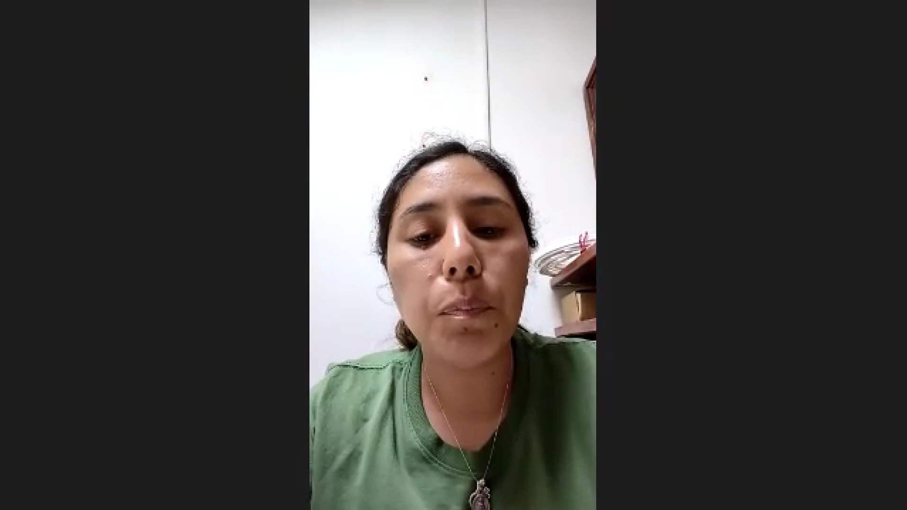 |
| Link | https://shorturl.at/c0pBO |
| Inicio | 19:23 min |
| Duración | 04:59 min |
| Resumen | Mariela Alanya Mercado es química farmacéutica y responsable del laboratorio de Control de Calidad del Centro Nacional de Productos Biológicos del Instituto Nacional de Salud. Sus funciones comprenden la supervisión de análisis, ensayos de calidad, gestión de recursos, mantenimiento de equipos y adquisición de insumos necesarios para las operaciones del laboratorio.  Para desarrollar sus actividades utiliza principalmente computadoras o laptops, Microsoft Excel, correos electrónicos y documentación física, además de registros digitales asociados al seguimiento de lotes y resultados analíticos.  La documentación gestionada incluye hojas de cálculo, formularios de control, registros de análisis, documentación técnica, expedientes de lotes y comunicaciones entre áreas relacionadas con la fabricación y evaluación de productos biológicos.  Una de las principales dificultades identificadas es que la información suele encontrarse distribuida entre archivos digitales, correos electrónicos, formularios físicos y documentación impresa, dificultando la búsqueda de antecedentes y aumentando el riesgo de pérdida, duplicidad o inconsistencia de registros.  Las incidencias y desviaciones detectadas durante la producción son comunicadas a las áreas correspondientes para su evaluación, investigación y aplicación de acciones correctivas.  Mariela considera que una plataforma centralizada permitiría integrar documentación, registros de lotes e información de calidad dentro de un mismo entorno, mejorando la trazabilidad, reduciendo actividades manuales y facilitando el acceso seguro a la información. |

| Numero | 3 |
|---------|--------|
| **Campo** | **Información** |
| Nombre | Rick |
| Apellido | Correidos |
| Edad | 25 |
| Distrito | Lima |
| Evidencia |  |
| Link | https://shorturl.at/c0pBO |
| Inicio | 24:26 min |
| Duración | 03:58 min |
| Resumen | Rick Correidos se desempeña como Supervisor de Producción Farmacéutica y cuenta con experiencia en la supervisión de procesos de fabricación y seguimiento de lotes. Entre sus principales responsabilidades se encuentran el monitoreo de la producción, la verificación del cumplimiento de parámetros operativos y la coordinación permanente con las áreas de calidad.  Para realizar sus actividades utiliza computadoras de escritorio, laptops, Microsoft Excel, correos electrónicos y sistemas internos de gestión documental. Asimismo, emplea registros físicos y digitales para documentar el avance de los procesos de fabricación.  La documentación que administra incluye registros de producción, formularios físicos, hojas de cálculo, reportes de desviaciones y documentación relacionada con el control de calidad y el estado de los lotes.  Una de las principales dificultades identificadas consiste en acceder rápidamente al historial completo de un lote, ya que la información suele encontrarse distribuida entre correos electrónicos, registros archivados, formularios físicos y distintas fuentes documentales.  Cuando ocurre una incidencia durante la fabricación, esta es registrada y comunicada al área de Calidad para su análisis e investigación. La coordinación entre Producción y Calidad es constante, aunque en ocasiones los procesos de validación y revisión documental generan retrasos en la obtención de información.  Rick considera que una plataforma centralizada que integre la información de producción, calidad y trazabilidad permitiría mejorar la comunicación entre áreas, agilizar auditorías y facilitar la toma de decisiones basada en información actualizada. |

### 2.2.3. Análisis de entrevistas

En esta sección se presenta el análisis detallado de la información recolectada. Para cada segmento, se explican primero los hallazgos estadísticos objetivos y subjetivos, seguidos de la evidencia gráfica correspondiente.

##### Segmento 1: Especialista de Aseguramiento y Control de Calidad (QA/QC)

**Caracteristicas Objetivas:**

- Respecto a la infraestructura tecnológica utilizada, el 100% utiliza computadoras o laptops como herramienta principal de trabajo. Asimismo, el 33% utiliza dispositivos Android como apoyo para actividades operativas y consulta de información.
- En relación con las tecnologías empleadas, el 100% utiliza sistemas digitales de registro o gestión institucional, mientras que el 33% utiliza Microsoft Word, el 33% utiliza Microsoft Excel y el 33% utiliza Google Chrome como herramientas complementarias para la gestión documental y el acceso a información corporativa.
- Además, el 100% trabaja bajo un modelo híbrido de documentación física y digital, administrando procedimientos, protocolos, registros, historiales, reportes y evidencias necesarias para auditorías o procesos regulatorios.
- Por otro lado, el 67% de los entrevistados manifestó dificultades relacionadas con la búsqueda, acceso o integración de información proveniente de diferentes fuentes, situación que genera retrasos en actividades de validación, consulta y seguimiento de registros.
- Finalmente, el 100% participa en procesos de gestión de incidencias, desviaciones, no conformidades o eventos que requieren trazabilidad y seguimiento documental, reflejando la necesidad de mantener información confiable y actualizada.

**Características Subjetivas:**

- Desde una perspectiva subjetiva, el 100% de los entrevistados manifestó una percepción favorable hacia la digitalización y automatización de procesos como mecanismo para mejorar la eficiencia operativa.
- Asimismo, el 67% considera que la automatización de actividades como la elaboración de reportes, la revisión de información y la consolidación de registros permitiría reducir significativamente la carga operativa y los errores humanos.
- De igual forma, el 67% expresó la necesidad de mejorar el acceso e integración de la información, especialmente cuando esta proviene de múltiples sistemas, áreas o entidades externas.
- Finalmente, el 100% coincide en la importancia de fortalecer la trazabilidad documental, la disponibilidad de información histórica y el cumplimiento normativo, considerando que una plataforma centralizada contribuiría a optimizar los procesos de calidad, mejorar la toma de decisiones y facilitar auditorías e inspecciones regulatorias.

***Gráficos***

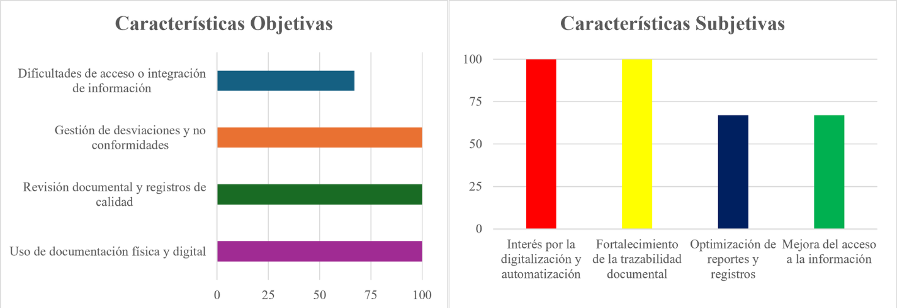

##### Segmento 2: Jefe o Supervisor de Producción Farmacéutica

**Caracteristicas Objetivas:**

- Respecto a los dispositivos de trabajo, el 67% de los entrevistados manifestó utilizar computadoras o laptops como herramienta principal para realizar actividades relacionadas con el seguimiento de lotes, gestión documental y consulta de información operativa.
- En relación con las tecnologías empleadas, el 67% utiliza Microsoft Excel como herramienta para registrar, controlar o analizar información relacionada con la producción, mientras que el 67% utiliza correos electrónicos para coordinar actividades con otras áreas. Además, el 33% utiliza sistemas internos de gestión documental para acceder y administrar registros asociados a la fabricación y control de calidad.
- Por otra parte, el 100% de los entrevistados utiliza registros físicos, formularios o documentación documental para realizar actividades de seguimiento y control de producción, evidenciando que gran parte de la trazabilidad continúa dependiendo de mecanismos manuales o esquemas híbridos de gestión de información.
- Asimismo, el 100% considera fundamental el seguimiento de lotes, las desviaciones, los resultados de calidad y los parámetros de producción para la toma de decisiones operativas. Sin embargo, el 67% manifestó dificultades para acceder rápidamente al historial completo de un lote debido a que la información se encuentra distribuida entre documentos físicos, correos electrónicos y archivos digitales independientes.

**Características Subjetivas:**

- Desde una perspectiva subjetiva, el 100% de los entrevistados manifestó interés en implementar una plataforma centralizada que permita integrar la información de producción, calidad y trazabilidad de los lotes.
- Asimismo, el 100% considera que la digitalización de registros y la reducción de procesos manuales permitirían mejorar la eficiencia operativa, disminuir los tiempos de búsqueda de información y reducir riesgos asociados a la duplicidad o pérdida de registros.
- De igual manera, el 67% destacó la necesidad de fortalecer la comunicación y el intercambio de información entre Producción y Calidad, especialmente durante la gestión de desviaciones, validaciones y actividades de seguimiento.
- Finalmente, el 100% coincide en que una mayor disponibilidad de información histórica, accesible desde una única plataforma, contribuiría a optimizar auditorías, mejorar la trazabilidad de los lotes y facilitar la toma de decisiones dentro del proceso productivo.

***Gráficos***

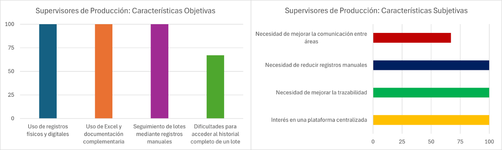

##### Análisis Comparativo

**Contrastación de Segmentos:**  Al comparar ambos segmentos se observa una coincidencia significativa en torno a la necesidad de mejorar la trazabilidad y centralizar la información relacionada con los lotes farmacéuticos. El 100% de los entrevistados, independientemente de su área de trabajo, manifestó utilizar esquemas mixtos que combinan documentación física y herramientas digitales, así como una valoración positiva hacia la incorporación de soluciones tecnológicas orientadas a reducir la dependencia de procesos manuales.

No obstante, se identifican diferencias en el enfoque de sus necesidades. Los especialistas de Aseguramiento y Control de Calidad priorizan la gestión documental, la validación de registros, el seguimiento de desviaciones, la preparación de auditorías y la generación de evidencias regulatorias. Por su parte, los Supervisores de Producción se enfocan principalmente en el monitoreo de los lotes, el control de las operaciones productivas, la gestión de incidencias y el acceso rápido a información que facilite la toma de decisiones operativas.

Estas diferencias evidencian la necesidad de una plataforma que integre la información generada por ambas áreas dentro de un único entorno, permitiendo a Producción y Calidad trabajar sobre los mismos datos, fortalecer la trazabilidad de los lotes y mejorar la coordinación entre los diferentes actores involucrados en el proceso farmacéutico.

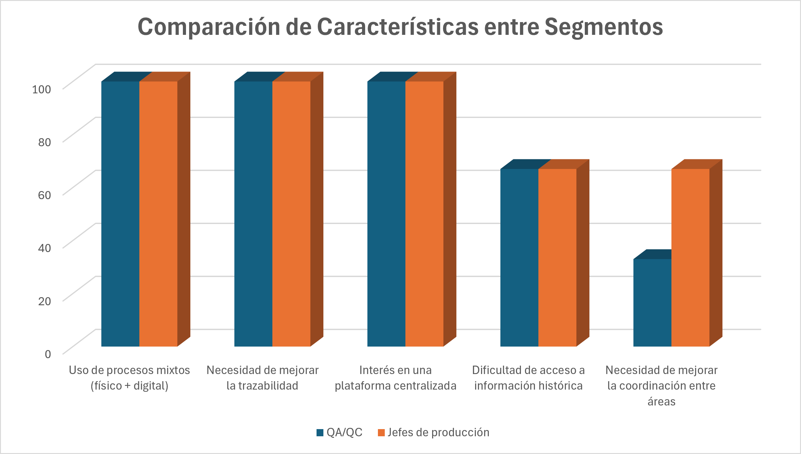

#### Conclusiones y Definición de Arquetipos

Basado en el análisis estadístico, se definen los siguientes perfiles para los User Personas:

1.  **User Persona Especialista de Control de Calidad:**

**Rasgo clave:** Busca garantizar el cumplimiento de los estándares de calidad y los requisitos regulatorios mediante una gestión eficiente de protocolos, documentación, desviaciones y evidencias asociadas a cada lote farmacéutico.

**Sustento:** La totalidad de los entrevistados de este segmento manifestó realizar actividades relacionadas con la validación documental, la revisión de registros, el seguimiento de desviaciones y la preparación de información para auditorías e inspecciones. Asimismo, identificaron la automatización de tareas operativas y la centralización de la información como factores clave para mejorar la eficiencia de sus actividades y fortalecer la trazabilidad de los procesos.

2.  **Jefe de Producción Farmacéutica:**

**Rasgo clave:** Busca supervisar eficientemente los procesos de fabricación mediante el acceso oportuno a información de producción, estados de los lotes e incidencias operativas, facilitando la toma de decisiones y la coordinación con las áreas de calidad.

**Sustento:** Los entrevistados pertenecientes a este segmento señalaron que gran parte de su trabajo depende de la consulta constante de registros de producción, parámetros operativos y resultados de calidad. Asimismo, identificaron que la dispersión de la información entre diferentes fuentes dificulta el seguimiento de los lotes y genera retrasos en la coordinación con otras áreas. Por ello, consideran prioritario contar con una plataforma centralizada que facilite la consulta histórica, fortalezca la trazabilidad y reduzca la dependencia de procesos manuales.

## 2.3. Needfinding

La etapa de Needfinding tiene como objetivo identificar y comprender las necesidades, problemas, motivaciones y oportunidades presentes en los segmentos objetivo de DoofPlus a partir de la información obtenida durante las entrevistas realizadas. Mediante el análisis de las experiencias y actividades de los profesionales de aseguramiento de calidad y producción farmacéutica, se busca reconocer los principales desafíos relacionados con la gestión documental, la trazabilidad de lotes, el acceso a la información y el cumplimiento regulatorio. Los hallazgos obtenidos en esta fase permiten transformar los datos recopilados en conocimientos relevantes para el proyecto, facilitando la identificación de necesidades reales de los usuarios y sirviendo como base para la definición de funcionalidades, requisitos y decisiones de diseño orientadas a generar una solución alineada con su contexto de trabajo.

### 2.3.1. User Personas

A partir del análisis de las entrevistas y la información recopilada sobre los procesos de aseguramiento de calidad y producción farmacéutica, se identificaron los principales perfiles de usuarios que interactuarían con la solución propuesta. Estos perfiles representan los segmentos clave para DoofPlus, ya que participan directamente en actividades relacionadas con la gestión de documentación de calidad, la trazabilidad de lotes, el seguimiento de incidencias y el cumplimiento de los requisitos regulatorios establecidos por el sector farmacéutico. La construcción de los User Persona permite comprender mejor sus necesidades, motivaciones, desafíos y hábitos de trabajo, proporcionando información valiosa para definir funcionalidades, priorizar requerimientos y diseñar una experiencia de usuario alineada con las problemáticas y expectativas de cada segmento objetivo.

**1) Segmento 1: Especialista de Aseguramiento y Control de Calidad (QA/QC)**

Para este segmento se elaboró el User Persona María México, tomando como referencia el perfil de los profesionales responsables de las actividades de aseguramiento y control de calidad dentro de laboratorios farmacéuticos. Se consideraron factores como su experiencia en validaciones, revisión documental, verificación de equipos y evaluación de personal analista, así como su participación en la gestión de protocolos, registros y auditorías regulatorias. Sus principales frustraciones se relacionan con la dependencia de procesos manuales para revisar cálculos, informes y documentación antes de registrar los resultados en los sistemas de la organización, lo que incrementa el tiempo invertido en tareas operativas y dificulta la preparación de evidencias para inspecciones y auditorías. Asimismo, se tomó en cuenta su necesidad de disponer de una plataforma que centralice la información de calidad, facilite la trazabilidad de los lotes, automatice la generación de reportes y reduzca la carga administrativa asociada a la gestión documental, permitiéndole dedicar más tiempo a actividades de supervisión y mejora continua de los procesos de calidad.

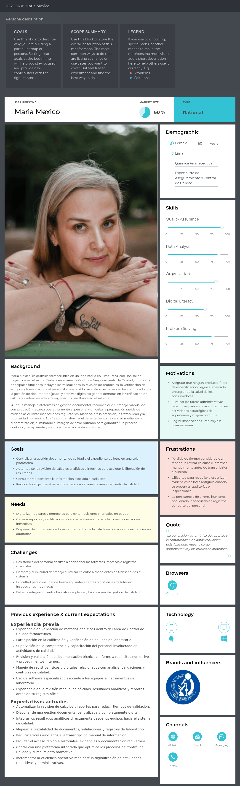

**2) Segmento 2: Jefe o Supervisor de Producción Farmacéutica**

Para este segmento se elaboró el User Persona Alberto Valle Vega. Se consideraron factores como su amplia experiencia en la industria farmacéutica, su responsabilidad en la supervisión de los procesos de fabricación y su participación en la coordinación con las áreas de aseguramiento y control de calidad. Sus principales motivaciones están orientadas a garantizar que la producción se desarrolle conforme a los procedimientos establecidos, manteniendo la calidad, la trazabilidad y el cumplimiento de los estándares regulatorios durante todas las etapas de fabricación. Entre sus principales dificultades se encuentra el acceso oportuno a información consolidada sobre los lotes en producción, así como la gestión y comunicación de incidencias que requieren seguimiento y documentación formal. Asimismo, se tomó en cuenta su necesidad de disponer de herramientas que faciliten la consulta del historial de producción, mejoren la coordinación entre las diferentes áreas involucradas y permitan acceder a información confiable para la toma de decisiones operativas, contribuyendo a una gestión más eficiente y a la reducción de errores durante el proceso productivo.

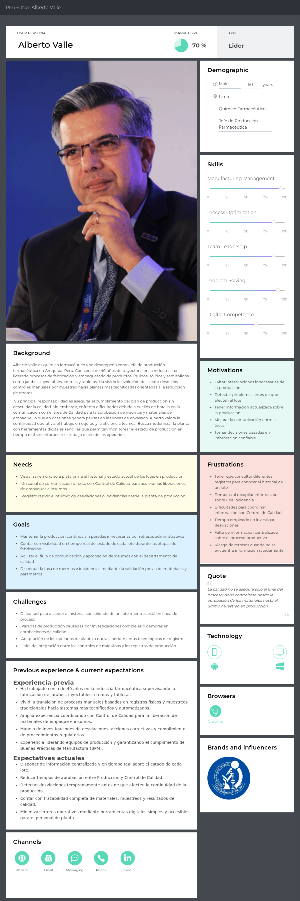

### 2.3.2. User Task Matrix

En esta sección se presenta el User Task Matrix, que concentra las tareas que los User Persona realizan para cumplir sus objetivos en su día a día, independientemente de la existencia de una solución de software. Para este análisis se consideran los dos segmentos objetivo identificados: el Especialista de Aseguramiento y Control de Calidad (QA/QC), representado por María México, y el Jefe de Producción Farmacéutica, representado por Alberto Valle. Se evalúa la frecuencia y la importancia de cada tarea para cada segmento con el fin de identificar dónde aportar mayor valor.

<table border="1" cellpadding="8" cellspacing="0" style="border-collapse:collapse; width:100%; font-family:Arial, sans-serif; text-align:center;">
  <thead>
    <tr style="background-color:#eef3f7;">
      <th rowspan="2">Tarea (Task)</th>
      <th colspan="2">Especialista QA/QC (María México)</th>
      <th colspan="2">Jefe de Producción (Alberto Valle)</th>
    </tr>
    <tr style="background-color:#eef3f7;">
      <th>Frecuencia</th>
      <th>Importancia</th>
      <th>Frecuencia</th>
      <th>Importancia</th>
    </tr>
  </thead>
  <tbody>
    <tr>
      <td style="text-align:left;">Consultar el historial y trazabilidad de un lote</td>
      <td>Often</td><td>High</td>
      <td>Often</td><td>High</td>
    </tr>
    <tr>
      <td style="text-align:left;">Registrar y dar seguimiento a desviaciones e incidencias</td>
      <td>Occasionally</td><td>High</td>
      <td>Occasionally</td><td>High</td>
    </tr>
    <tr>
      <td style="text-align:left;">Revisar y validar cálculos analíticos e informes de calidad</td>
      <td>Often</td><td>High</td>
      <td>Rarely</td><td>Low</td>
    </tr>
    <tr>
      <td style="text-align:left;">Gestionar protocolos, registros y documentación de calidad</td>
      <td>Often</td><td>High</td>
      <td>Occasionally</td><td>Medium</td>
    </tr>
    <tr>
      <td style="text-align:left;">Recopilar evidencias para auditorías e inspecciones</td>
      <td>Occasionally</td><td>High</td>
      <td>Rarely</td><td>Medium</td>
    </tr>
    <tr>
      <td style="text-align:left;">Supervisar el estado de los lotes durante la fabricación</td>
      <td>Rarely</td><td>Low</td>
      <td>Often</td><td>High</td>
    </tr>
    <tr>
      <td style="text-align:left;">Coordinar la aprobación de insumos y materiales con Calidad</td>
      <td>Rarely</td><td>Medium</td>
      <td>Often</td><td>High</td>
    </tr>
  </tbody>
</table>

**Análisis del Task Matrix:**
Se observa que las tareas **"Consultar el historial y trazabilidad de un lote"** y **"Registrar y dar seguimiento a desviaciones e incidencias"** presentan una Importancia **High** para ambos segmentos, confirmando que la trazabilidad centralizada y la gestión de desviaciones son las necesidades más críticas y compartidas del negocio. Las principales diferencias radican en que María México concentra su actividad diaria en tareas documentales de aseguramiento —como revisar cálculos analíticos, gestionar protocolos y recopilar evidencias para auditorías (todas con Importancia High para ella)—, mientras que Alberto Valle prioriza la supervisión operativa de la fabricación y la coordinación de aprobaciones de insumos con el área de Calidad (Often / High). Esta complementariedad evidencia que ambos perfiles dependen de información oportuna sobre los mismos lotes, pero desde perspectivas distintas, lo que valida la necesidad de una plataforma que centralice dicha información y facilite la comunicación entre las áreas de Producción y Calidad.

### 2.3.3. User Journey Mapping

**Segmento 1 – Especialista de Aseguramiento y Control de Calidad (María México)**

El User Journey Map de María ilustra su recorrido integral (end-to-end) en el proceso de validación documental y liberación de lotes de producción. Este diagrama documenta su flujo de trabajo paso a paso: desde la recepción de expedientes de planta en formato físico, pasando por la verificación de cálculos analíticos, hasta la transcripción de datos y la búsqueda de antecedentes frente a auditorías inopinadas.

En el escenario actual (As-Is), María se desenvuelve en un entorno altamente dependiente del papel que limita su eficiencia. Su rutina le exige auditar registros manuales, rehacer cálculos con calculadora para evitar errores operativos y digitar extensamente información hacia sistemas desconectados. Estas tareas repetitivas no solo duplican su carga laboral, sino que ralentizan la liberación del producto y generan picos de estrés cuando debe rastrear evidencias físicas en los archivos para los inspectores.

El análisis de su mapa evidencia estos quiebres operativos y emocionales, justificando la necesidad de nuestra solución tecnológica para digitalizar la captura de datos en el origen, automatizar los cálculos de calidad y centralizar el historial de los lotes en una base de datos accesible al instante.

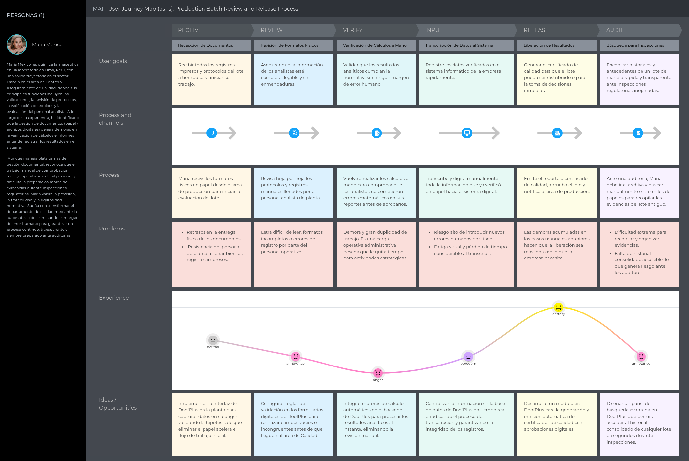

**Segmento 2 – Jefe de Producción Farmacéutica (Alberto Valle)**

El User Journey Map de Alberto detalla el ciclo operativo que experimenta al liderar la fabricación diaria en la planta. El recorrido abarca desde la revisión de la planificación del turno y el arranque de las máquinas, hasta la solicitud de validaciones de calidad, la gestión de incidencias operativas y el cierre de la orden de producción.

Bajo la situación actual (As-Is), el principal obstáculo en la experiencia de Alberto es la falta de visibilidad y la comunicación fragmentada. Al depender de formatos impresos y esperas presenciales para lograr la aprobación de insumos por parte de Calidad, la línea de envasado sufre paradas innecesarias. Sumado a esto, registrar desviaciones operativas a mano dificulta la trazabilidad y retrasa la toma de decisiones.

Este mapa expone cómo la desconexión interdepartamental impacta negativamente en la continuidad de la producción, generando frustración en su perfil de liderazgo. A partir de la identificación de estos puntos de dolor, se establecen las bases para diseñar un sistema que ofrezca comunicación directa, validaciones ágiles y un tablero de control integrado para optimizar los tiempos de la fábrica.

### 2.3.4. Empathy Mapping
Para la elaboración de los Empathy Maps, el equipo partió del conocimiento y observaciones recolectadas durante el análisis de los User Persona. Se colocó al centro de cada mapa al usuario correspondiente (María México y Alberto Valle Vega) y se respondieron las preguntas claves sobre su entorno, emociones, comportamientos y necesidades.

**1) Segmento 1: Especialista de Aseguramiento y Control de Calidad (QA/QC)**

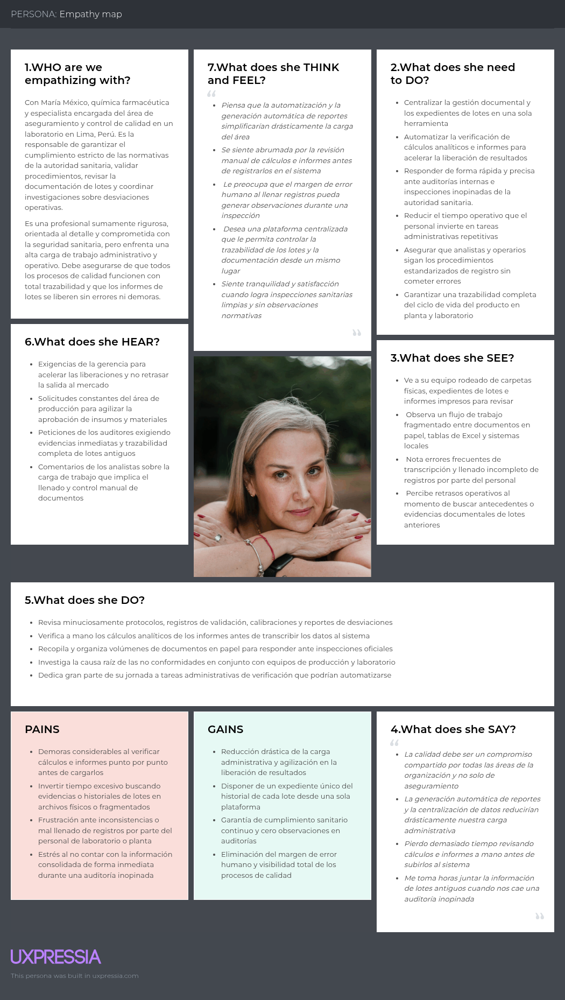

En este mapa se analizó a María México, química farmacéutica encargada del área de aseguramiento y control de calidad en un laboratorio farmacéutico. Se identificó que piensa constantemente en la necesidad de automatizar procesos e informes para liberar la alta carga administrativa del departamento, preocupándose por el riesgo de errores humanos al momento de revisar registros manualmente. Escucha la exigencia de la gerencia para agilizar la entrega de documentación y de las autoridades de salud requerir trazabilidad inmediata. Observa el entorno cargado de expedientes físicos, tablas dispersas y la recurrencia de errores de llenado por parte del personal. María expresa la necesidad de reducir la carga operativa y actúa revisando minuciosamente cálculos a mano e investigando desviaciones operativas junto a su equipo. Su dolor principal es el tiempo invertido en revisiones manuales y la dificultad para recopilar evidencias en auditorías inopinadas, mientras que su ganancia esperada es disponer de generación automática de reportes, un expediente de lotes centralizado y tranquilidad en el cumplimiento normativo.

**2) Segmento 2: Jefe o Supervisor de Producción Farmacéutica**

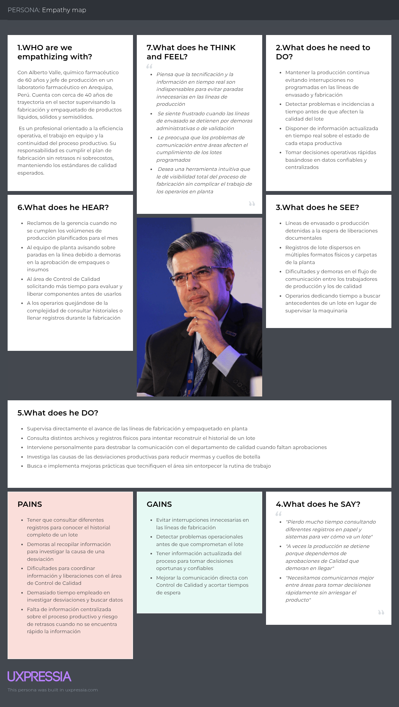

En este mapa se analizó a Alberto Valle, jefe de producción farmacéutica con amplia experiencia en la supervisión de líneas de fabricación. Él piensa en la importancia de integrar información en tiempo real para evitar interrupciones innecesarias en las líneas de envasado. Escucha los reclamos cuando se retrasan las metas de fabricación y los avisos de planta sobre paradas de línea por demoras en las aprobaciones del área de calidad. Observa la dispersión de los registros de lote en papel y las dificultades en la comunicación entre el personal de planta y los departamentos de apoyo. Alberto suele expresar la urgencia de tecnificar la planta y actúa supervisando directamente los avances en línea e investigando las causas de las mermas o desviaciones. Su dolor principal es tener que consultar diferentes registros fragmentados y las demoras al coordinar liberaciones de insumos con Control de Calidad, mientras que su ganancia esperada es garantizar la continuidad productiva, detectar problemas de forma preventiva y tomar decisiones oportunas basadas en datos confiables.

## 2.4. Big Picture Event Storming

Para comprender el dominio del negocio de DoofPlus de punta a punta, el equipo realizó una sesión colaborativa de Big Picture EventStorming en Miro, siguiendo la guía paso a paso indicada en el statement (https://bit.ly/bpes-guide). El alcance de la sesión fue el ciclo de vida completo de un lote farmacéutico dentro de un laboratorio cliente: desde que la organización se registra en la plataforma hasta que el lote se libera y sus evidencias se presentan en una auditoría. Los integrantes del equipo trabajaron con la información de las entrevistas (sección 2.2) y los artefactos de needfinding (sección 2.3) como base.

Tablero de Miro: https://miro.com/app/board/uXjVHl-67N8=/

Antes de generar eventos se cumplieron los pasos 1 a 3 de la guía: se preparó el tablero con una franja de tiempo de izquierda a derecha, se acordó la agenda y se presentó la notación:

| Elemento | Color | Uso en la sesión |
| --- | --- | --- |
| Domain event | Naranja | Hecho relevante del negocio, redactado en pasado (por ejemplo, "Lote cerrado"). |
| Actor | Amarillo (pequeño) | Persona o rol que provoca o atiende el evento. |
| External system | Azul | Sistema u organización externa que interviene (Niubiz, ThingsBoard, Lector RFID, DIGEMID). |
| Problema u oportunidad (hotspot) | Rosado | Dificultad detectada en la situación actual. |
| Pivotal event | Naranja (de mayor tamaño) | Evento que cambia de fase el proceso. |

**Step 4 – Generating Domain Events**

Cada integrante escribió en post-its naranjas, sin orden y en tiempo pasado, los hechos que ocurren en un laboratorio cuando se fabrica y controla un lote. Se obtuvieron 67 eventos que cubren la administración de la plataforma, la gestión documental, la producción, el monitoreo de equipos, el control de calidad, las desviaciones y la auditoría.

Frame en Miro: https://miro.com/app/board/uXjVHl-67N8=/?moveToWidget=3458764685732289571

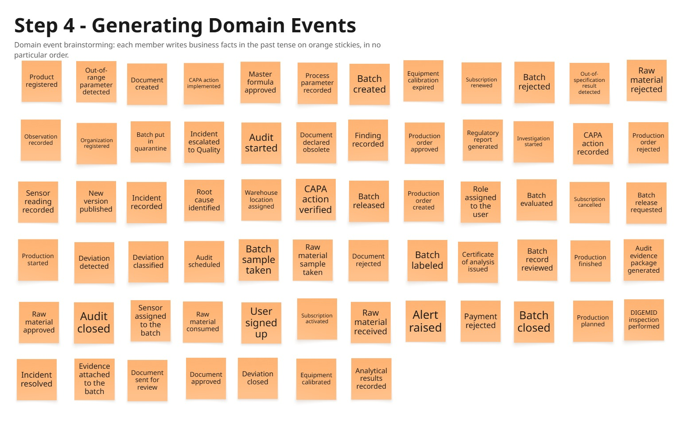

**Step 5 – Sorting Domain Events**

Los eventos se ordenaron cronológicamente de izquierda a derecha. Los resultados alternativos de un mismo momento (por ejemplo, "Materia prima aprobada" o "Materia prima rechazada") se ubicaron en vertical, y los flujos que ocurren en paralelo se separaron en siete swimlanes: Plataforma y administración, Gestión documental, Producción y almacén, Monitoreo de equipos (IoT), Control de calidad y liberación, Desviaciones y CAPA, y Auditoría y cumplimiento. Al ordenar se eliminaron los eventos duplicados.

Frame en Miro: https://miro.com/app/board/uXjVHl-67N8=/?moveToWidget=3458764685732347233

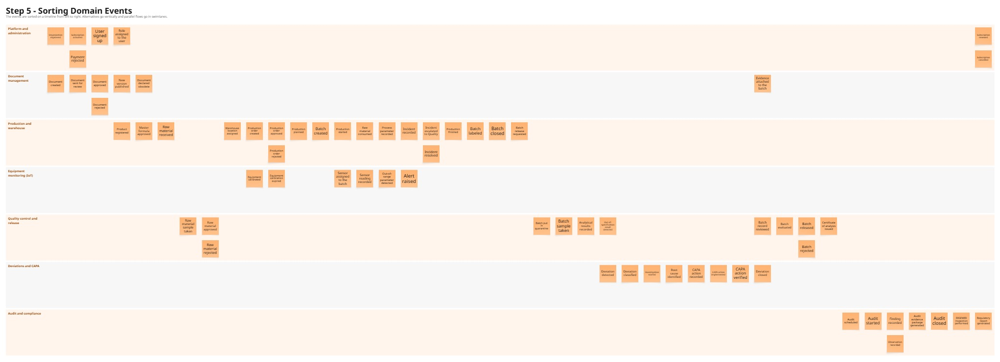

**Step 6 – Adding Actors and External Systems**

Sobre la línea de tiempo se agregaron los actores que provocan cada grupo de eventos (Administrador del laboratorio, Especialista QA/QC y Jefe de Producción) y los sistemas externos con los que interactúa el proceso: Niubiz para el cobro de suscripciones, el Lector RFID en la recepción de insumos, los sensores IoT conectados a ThingsBoard y DIGEMID como entidad que realiza la inspección.

Frame en Miro: https://miro.com/app/board/uXjVHl-67N8=/?moveToWidget=3458764685732347919

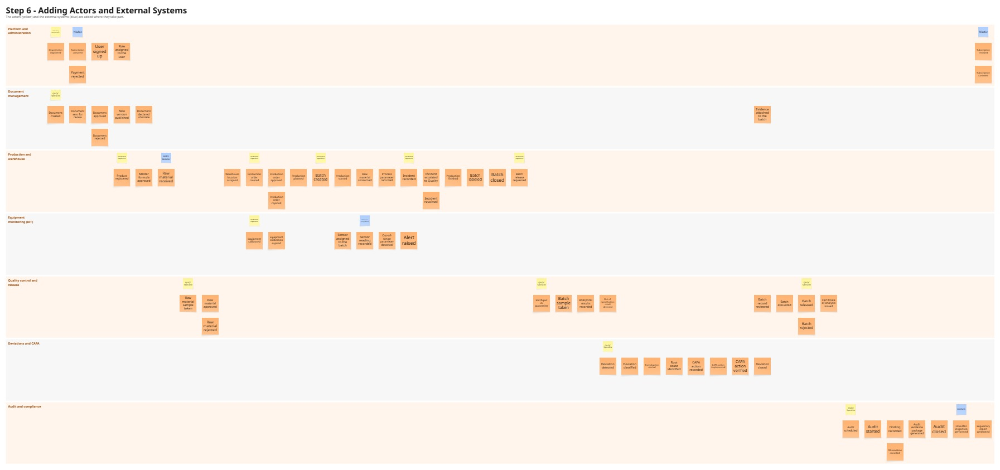

**Step 7 – Storytelling**

Un integrante narró la historia completa de inicio a fin mientras el resto validaba el orden y el significado de cada evento. Durante la narración se registraron en rosado los problemas que hoy enfrentan los laboratorios, tomados de las entrevistas, y se conectaron con flechas los eventos que disparan a otros (por ejemplo, "Parámetro fuera de rango detectado" dispara "Alerta generada", que genera una "Incidencia registrada"). Los pivotal events, destacados con un post-it de mayor tamaño, marcan los cambios de fase del lote: "Materia prima recibida", "Lote creado", "Lote cerrado", "Muestra de lote tomada", "Registro de lote revisado", "Lote liberado", "Auditoría iniciada" y "Auditoría cerrada".

| Problema detectado | Evidencia en las entrevistas |
| --- | --- |
| Recepción de insumos registrada en papel | Mariela, que también gestiona la adquisición de insumos, y Rick registran la información en formularios físicos y hojas de cálculo. |
| Producción espera la aprobación de insumos | Alberto explica que los materiales deben ser aprobados por Calidad antes de usarse y Rick señala que la coordinación es lenta por las validaciones manuales. |
| Calibraciones controladas en hojas de cálculo | Julia participa en la calibración y calificación de equipos y trabaja con Word y Excel. |
| Parámetros transcritos a mano | Rick documenta parámetros operativos en registros físicos. |
| Historial del lote disperso en papel, Excel y correos | Mariela y Rick señalan que reconstruir el historial de un lote es la principal dificultad. |
| Cálculos analíticos revisados a mano | María revisa cálculos e informes manualmente antes de registrarlos. |
| Análisis de causa raíz débil | Julia identifica la falta de análisis de causas reales como oportunidad de mejora. |
| Reunir evidencias para una auditoría toma días | María mantiene registros para auditorías y considera que la generación automática de reportes reduciría su carga; Julia participa en las auditorías. |

Frame en Miro: https://miro.com/app/board/uXjVHl-67N8=/?moveToWidget=3458764685732393843

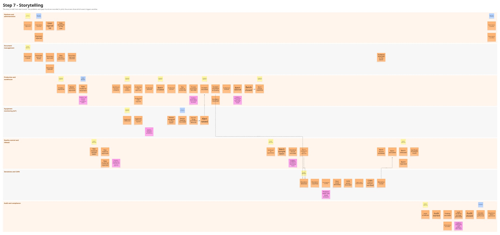

## 2.5. Ubiquitous Language

En este proyecto, cuyo objetivo principal es mejorar la trazabilidad, la gestión documental y la eficiencia en los procesos de calidad de laboratorios y plantas farmacéuticas mediante la plataforma DoofPlus, se ha definido el siguiente **lenguaje ubicuo (ubiquitous language)** para asegurar claridad y consistencia entre desarrolladores, usuarios (QA/QC, Jefes de Producción) y stakeholders:

| Term (Término) | Definition (Definición) |
|---|---|
| Batch (Lote) | Cantidad definida de un producto farmacéutico elaborado en un mismo ciclo de fabricación, caracterizada por su homogeneidad. |
| Batch Record (Expediente de Lote) | Conjunto consolidado de documentos físicos o digitales que proporcionan el historial completo de la producción, controles y distribución de un lote específico. |
| Product (Producto) | Medicamento que el laboratorio fabrica, identificado por un código único; se elabora según su fórmula maestra aprobada. |
| Master Formula (Fórmula maestra) | Documento aprobado que define los componentes y cantidades de un producto; cada lote se fabrica según una versión aprobada de la fórmula. |
| Production Order (Orden de producción) | Autorización para fabricar una cantidad planificada de un producto según su fórmula maestra; origina uno o más lotes. |
| Raw Material (Materia Prima / Insumo) | Toda sustancia, activa o inactiva, que es empleada e incorporada durante el proceso de formulación o fabricación de un producto farmacéutico. Se recibe por lote de proveedor y queda en cuarentena hasta su aprobación. |
| Storage Location (Ubicación de almacén) | Lugar del almacén asignado a un insumo recibido; queda registrado en su historial para ubicarlo durante la cuarentena y el consumo. |
| Process Parameter (Parámetro de proceso) | Variable operativa de una etapa de fabricación (por ejemplo, temperatura o tiempo de mezcla) cuyo valor se registra y queda vinculado al historial del lote. |
| Incident (Incidencia) | Evento anómalo que Producción registra durante la fabricación; si es crítico detiene el lote (On Hold) y puede escalarse a Calidad como desviación. |
| Traceability (Trazabilidad) | Capacidad de rastrear y reconstruir el historial completo, la aplicación o la ubicación de un lote farmacéutico a lo largo de toda su cadena de producción. |
| Good Manufacturing Practices / GMP (Buenas Prácticas de Manufactura / BPM) | Conjunto de normativas y lineamientos regulatorios (como los exigidos por DIGEMID) que aseguran que los productos se fabriquen y controlen de forma consistente. |
| Quality Assurance / QA (Aseguramiento de Calidad) | Conjunto de acciones planificadas y sistemáticas necesarias para garantizar que un producto farmacéutico se fabrique cumpliendo los estándares de calidad exigidos. |
| Quality Control / QC (Control de Calidad) | Conjunto de pruebas, muestreos y verificaciones analíticas que comprueban que los insumos y los productos cumplen sus especificaciones técnicas. |
| Standard Operating Procedure / SOP (Procedimiento operativo estándar) | Documento controlado que describe paso a paso cómo ejecutar una actividad; solo la versión aprobada vigente puede aplicarse. |
| Analytical Protocol (Protocolo Analítico) | Documento técnico normado que describe detalladamente los métodos, equipos y criterios de aceptación utilizados para realizar las pruebas de control de un producto. |
| Document Version (Versión de documento) | Edición numerada de un documento controlado con su autor, fecha y motivo de cambio; al aprobarse una nueva versión, la anterior queda obsoleta. |
| Sample (Muestra) | Porción de un insumo o de un lote que Calidad toma para realizar los ensayos analíticos que sustentan su dictamen. |
| Analytical Result (Resultado analítico) | Valor obtenido en un ensayo de control de calidad, calculado según la fórmula del protocolo y comparado con su especificación. |
| Quarantine (Cuarentena) | Estado en que un insumo o un lote no puede usarse ni distribuirse hasta que Calidad emita su dictamen. |
| Out of Specification / OOS (Resultado fuera de especificación) | Resultado analítico que no cumple el rango de aceptación del protocolo; obliga a registrar una desviación. |
| Deviation (Desviación) | Cualquier alteración, no conformidad o evento imprevisto que se aleje de los procedimientos, protocolos o especificaciones establecidos, detectado durante la fabricación, en un resultado de control de calidad o al escalar una incidencia de Producción; se registra, investiga y cierra con su causa raíz y CAPA. |
| Root Cause Analysis / RCA (Análisis de causa raíz) | Investigación estructurada (por ejemplo, 5 porqués o Ishikawa) que identifica el origen de una desviación; sin causa raíz no se puede cerrar la desviación. |
| CAPA (Acción correctiva y preventiva) | Acción con responsable y fecha límite que corrige una desviación y evita su recurrencia; se verifica su eficacia antes de cerrarla. |
| Batch Release (Liberación de Lote) | Aprobación formal otorgada por el área de calidad que certifica que un lote ha sido fabricado según las normativas y parámetros, permitiendo su fase de distribución comercial. |
| Certificate of Analysis (Certificado de análisis) | Documento firmado que acredita los resultados analíticos de un lote liberado. |
| Audit (Auditoría) | Revisión sistemática e independiente, ya sea interna o realizada por entidades regulatorias, para evaluar el estricto cumplimiento de las normativas y reportes de calidad. |
| Finding / Observation (Hallazgo / Observación) | Incumplimiento (hallazgo) o recomendación de mejora (observación) registrado durante una auditoría. |
| Audit Evidence Package (Expediente de auditoría) | Conjunto de evidencias de un rango de fechas o de lotes (registros, certificados, firmas y audit trail) que se entrega a los auditores o inspectores. |
| Regulatory Report (Reporte regulatorio) | Informe periódico estandarizado con los registros de calidad del laboratorio, preparado para la autoridad sanitaria o para la revisión interna. |
| Regulatory Inspection (Inspección regulatoria) | Visita de la autoridad sanitaria (DIGEMID) al laboratorio para verificar el cumplimiento de las BPM. |
| Audit Trail (Registro de auditoría) | Registro inalterable de quién, cuándo, qué y por qué cambió en cada registro de calidad. |
| Electronic Signature (Firma electrónica) | Confirmación de identidad del usuario con su contraseña al aprobar, revisar o liberar un registro; incluye nombre, fecha, hora y significado. |
| Equipment (Equipo) | Máquina o instrumento de producción o de laboratorio, identificado por su número de serie, cuya calibración y mantenimiento determinan si es apto para fabricar. |
| Calibration (Calibración) | Verificación periódica de un equipo o sensor contra un patrón; si vence, el equipo queda no apto para producción. |
| IoT Sensor (Sensor IoT) | Dispositivo instalado en un equipo que mide una variable crítica y envía sus lecturas a través de ThingsBoard; se asocia al lote en fabricación. |
| Sensor Reading (Lectura de sensor) | Valor de una variable crítica (temperatura, humedad, presión, pH) enviado por un sensor y asociado al lote en curso. |
| Alert (Alerta) | Aviso generado cuando una lectura sale del rango permitido; puede derivar en una incidencia. |
| Organization (Organización) | Laboratorio farmacéutico cliente registrado en DoofPlus con su razón social y RUC; agrupa sus plantas, usuarios y suscripción. |
| Role (Rol) | Conjunto de permisos que el administrador del laboratorio asigna a un usuario (por ejemplo, QA Specialist o Production Supervisor) y que determina qué acciones puede realizar. |
| Subscription Plan (Plan de suscripción) | Modalidad comercial de DoofPlus (Standard Lab o Enterprise) que define el precio y los límites de usuarios y sensores. |

**Beneficios esperados del Ubiquitous Language:**
- Facilita la comunicación directa sin ambigüedades entre desarrolladores de software, especialistas de QA/QC, Jefes de Producción y otros stakeholders.
- Mejora la comprensión profunda del core de negocio farmacéutico (domain) para la implementación de reglas de validación en la plataforma DoofPlus.
- Evita errores de interpretación conceptual en el diseño de los expedientes digitales y flujos de aprobación.
- Asegura consistencia y coherencia entre la documentación técnica, las interfaces de usuario del sistema (dashboards) y el código fuente.
